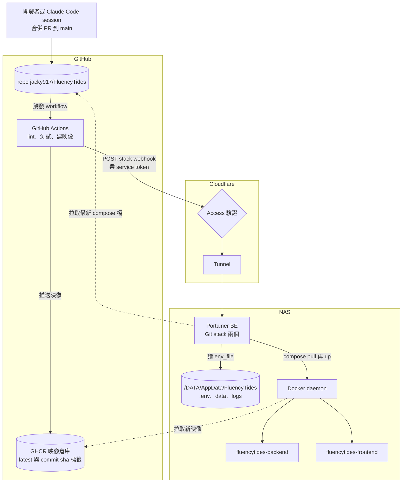
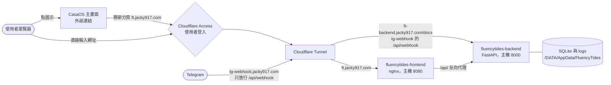
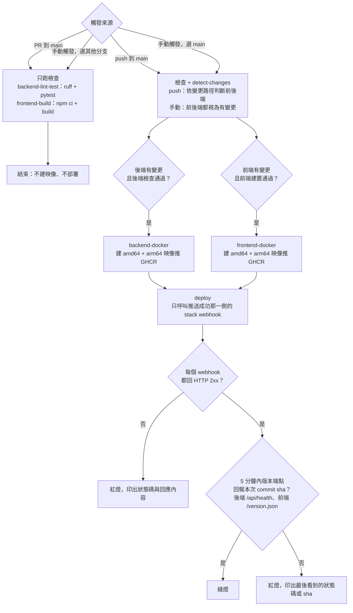
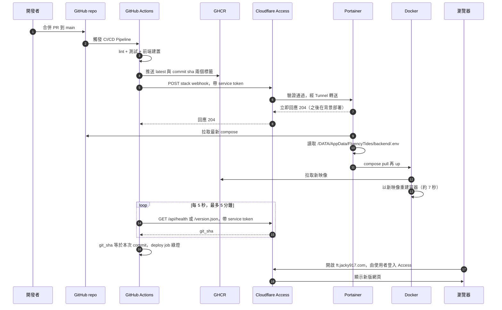
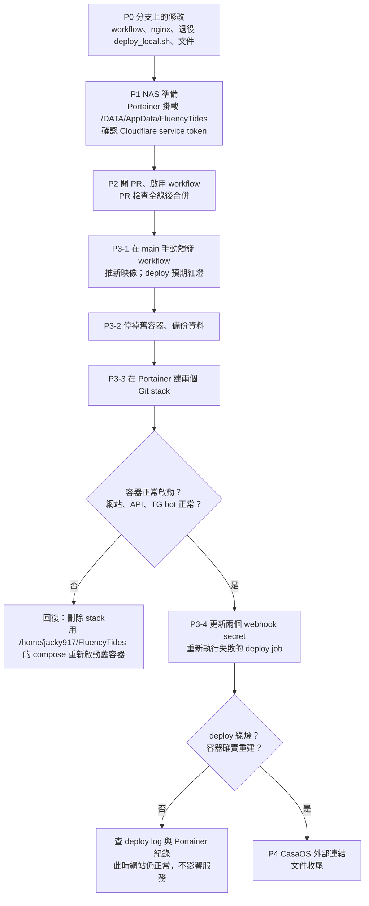

# FEAT — 重建 CI/CD：Portainer Git stack 自動部署，CasaOS 只當網頁入口

| 欄位 | 內容 |
|---|---|
| **創建日期** | 2026-10-20 |
| **性質** | 部署流程重新設計 + 實作工作項（含 NAS 端手動步驟） |
| **狀態** | 🚧 實作中（P0～P3 完成，進行 P4） |
| **範圍** | `.github/workflows/main.yml`、`.github/scripts/wait_for_deploy.py`、`frontend/nginx.conf.template`、`deploy_local.sh`（退役）、`README.md`；R1 追加：前後端 Dockerfile、`backend/app/api/health.py`；NAS 端：Portainer 掛載、兩個 Portainer Git stack、CasaOS 外部連結；GitHub：secrets 與 workflow 啟用狀態 |
| **不動** | 後端 / 前端應用程式碼（例外：R1 為 `/api/health` 加 `git_sha` 欄位）；`backend/docker-compose.yml` 與 `frontend/docker-compose.yml` 的服務定義（映像、掛載、網路、`env_file` 路徑全部照舊）；Cloudflare Tunnel 既有 hostname；Portainer 版本升級；資料庫內容 |
| **PR / 進度** | P0 → [#28](https://github.com/jacky917/FluencyTides/pull/28)（已合併 2026-10-20，034d4de）；P1、P3 完成 2026-10-20；後端 stack 改名 → [#29](https://github.com/jacky917/FluencyTides/pull/29)（已合併 2026-10-20，59151a4）；R1 部署結果驗證 → [#31](https://github.com/jacky917/FluencyTides/pull/31)（待合併） |
| **關聯文件** | `docs/bk/05_DevOps_and_Deployment.md`（舊部署說明，F059 即「部署失敗不報錯」）、`docs/archive/claude_cli_in_container_FEAT_2026-08-29.md` §5（記載「CI 已停用」） |

---

## 1. 問題與動機

GitHub Actions 的 CI/CD 自 2026-08-27 起被手動停用，之後正式站靠在 NAS 上手動執行 `deploy_local.sh` 部署。
想重新啟用 CI/CD，讓「push 到 main → 自動部署 → 打開網頁看效果」成為日常流程（也是雲端 session 驗收畫面的前提）。

### 1.1 調查結果

| # | 發現 | 證據 | 定位程度 |
|---|---|---|---|
| F1 | workflow 在 GitHub 上是 `disabled_manually` | `gh workflow list --all` | 已定位 |
| F2 | **自動部署從未成功過**：抽查 08-10 ~ 08-15 共 5 次綠燈的 run，Portainer webhook 全部回 HTTP 500；curl 沒檢查狀態碼，所以 CI 照樣綠燈 | 舊 `main.yml` deploy job 的 `curl -s -o /dev/null -w ...`（無 `--fail`）；各 run 的 log `HTTP Status: 500` | 已定位 |
| F3 | Portainer 裡目前**一個 webhook 都沒有**，也沒有 FluencyTides 的 stack | Portainer API `GET /api/webhooks?filters={"EndpointID":3}` 回空陣列、`GET /api/stacks` 無相關項目 | 已定位 |
| F4 | 正式站兩個容器是 `deploy_local.sh` 在主機上以 compose 建立（工作目錄 `/home/jacky917/FluencyTides/{backend,frontend}`），不屬於 Portainer，也不屬於 CasaOS | 容器標籤 `com.docker.compose.project.working_dir`；CasaOS 安裝的 app 都在 `/var/lib/casaos/apps/<名稱>` 且帶 `icon` 標籤，FluencyTides 兩者皆無 | 已定位 |
| F5 | 500 的成因：Portainer 的 container webhook 綁的是**容器 ID**，`deploy_local.sh`（2026-08-09 加入）每次 `--force-recreate` 都換掉容器 ID，webhook 便指向不存在的容器 | 時間線吻合（08-10 第一次記錄就是 500）；Portainer CE 原始碼中 token 不存在時回 404 而非 500，代表當時 webhook 存在但目標失效。container webhook 是 BE 閉源功能，無法看原始碼確認。**2026-10-20 實證**：合併 #28 後的 run（39354521704）呼叫舊 webhook，Portainer 回 `Error updating service … No such container: 1524ccc117dd…` | **已定位**（2026-10-20 由新版 deploy 印出的回應證實） |
| F6 | 08-27 讓 CI 變紅的 ruff 錯誤（`LLMClient` 未定義）已修好 | 本機 `ruff check app scripts tests` 全過 | 已定位 |
| F7 | GHCR 上的 `:latest` 停在 08-15，比正式站舊很多 | GHCR 最後一次推送是 08-15 的 run | 已定位 |
| F8 | GHCR 映像是公開的，NAS 拉取不需登入；NAS 為 x86_64 | 匿名取 manifest 回 200；Portainer `docker/info` | 已定位 |

### 1.2 為什麼不只是「重建 webhook」

重建 container webhook 能讓 CI 暫時恢復，但只要容器在 Portainer 之外被重建一次（`deploy_local.sh`、手動 compose、CasaOS 操作），又會回到 F5 的狀態。
根本問題是**同一組容器沒有唯一的管理者**，所以這次一併把管理權收斂到一處。

## 2. 目標與非目標

**目標**
- G1 push 到 main（後端或前端有變更）後，不需人工介入，正式站自動更新到新版本。
- G2 部署任何一步失敗，GitHub Actions 必定顯示紅燈，不再有「假綠燈」。
- G3 FluencyTides 的容器只有一個管理者（Portainer），設定變更有固定做法，且不會讓自動部署失效。
- G4 CasaOS 主畫面保留點擊即開網頁的入口，但 CasaOS 無法修改、重建或解除安裝 FluencyTides。
  > 2026-10-20 實機結果：部分達成。CasaOS 沒有設定、重建、解除安裝的按鈕，但兩個容器列在「Legacy app」區塊並有「Import to CasaOS」動作（需二次確認），見 D5 更正與 R11。
- G5 每個步驟都有回復方式，切換過程資料零遺失。

**非目標**
- 不改用 Watchtower。評估過：它能讓 CasaOS 繼續管理容器，但部署就不經過 Portainer，BE 授權的價值變低（見 D1）。
- 不自動同步 CasaOS 外部連結（網域變更頻率很低，改用 §8 檢查清單人工維護）。
- 不做 staging / 預覽環境。目前只有正式站；功能分支要在網頁上看效果仍需合併，這是之後的獨立議題。
- 不改映像標籤策略（仍部署 `:latest`；`:<commit sha>` 標籤照舊推送，供回滾用）。
- 不處理「測試會讀到本機 `backend/.env`」的隔離問題（在 `backend/` 目錄執行 pytest 時有 2 個測試因本機 `.env` 失敗；CI 沒有 `.env` 不受影響）。另案處理。
- 不升級 Portainer（2.39.2 LTS → 2.45.2）。
  > **2026-10-20 實作時已被動升級**：P1 在 CasaOS 儲存 Portainer 設定時，因映像標籤為 `latest` 而重新拉取，Portainer 升到 2.45.2 LTS（資料庫一併遷移，無法降版）。升級後運作正常，詳見 §9 R10。

## 3. 設計決策

### D1 由 Portainer 當唯一管理者（放棄 CasaOS + Watchtower、放棄 container webhook）

| 方案 | 綁定對象 | 容器在外部重建後 | 改設定的地方 | 結論 |
|---|---|---|---|---|
| A. 重建 container webhook | 容器 ID | 失效 | 主機上的 compose 檔 | ✗ 治標，F5 會重演 |
| B. **Portainer Git stack + stack webhook** | stack | 不受影響（重建本來就由 Portainer 執行） | Git（compose）＋ NAS 上的 `.env` | ✓ 採用 |
| C. CasaOS app + Watchtower | 容器名稱 | 不受影響 | CasaOS | ✗ 部署不經 Portainer；另需維護 Watchtower |

選 B 的理由：Portainer BE 已有授權，Git stack 讓 compose 的修改走 git（有紀錄、可審查），部署、設定、log 都在同一個介面。

### D2 Git stack 的設定：Webhook 觸發 + Re-pull image + Force redeployment

已在 Portainer 2.39.2 BE 的「新增 stack」表單確認以下選項存在（2026-10-20，只檢視未送出）：

| 選項 | 設定 | 理由 |
|---|---|---|
| Build method | Repository | compose 直接取自 GitHub repo（公開，免驗證） |
| Repository reference | `refs/heads/main` | 只部署 main |
| GitOps updates | 開 | |
| Mechanism | **Webhook**（不用 Polling） | Polling 會在 commit 一出現就重新部署，此時 CI 可能還沒推好新映像，會拉到舊的 `:latest`。由 CI 在推完映像後才呼叫 webhook，順序才正確 |
| Re-pull image | 開 | 程式碼變更只改映像、不改 compose，必須重新拉映像才會更新 |
| Force redeployment | 開 | 確保即使 Git 內容判定為「無變更」也會重新部署（Portainer 判斷變更的細節未查證，開啟可避免依賴它） |
| Enable relative path volumes | 關 | 所有掛載都是主機絕對路徑，不需要 |
| Environment variables | 後端不設；前端視需要設 `API_SECRET_KEY` | 見 D4 |

注意：GitOps 開啟後，在 Portainer 介面直接修改 stack 內容，會在下次部署時被 Git 的版本覆蓋（表單上的官方警語）。**compose 的修改一律走 git。**

> **2026-10-20 實作時的介面差異（Portainer 2.45.2 LTS）**：P1 時 Portainer 被升到 2.45.2（§9 R10），新增 stack 的表單和上表不同：
> - Git repository 不再直接填網址，改成先到 **App Delivery → Sources** 建立 Git Source（本次建立 `fluencytides`：`https://github.com/jacky917/FluencyTides`，關閉 Authentication、不開 polling，存取控制 Administrators），stack 表單再選這個 Source。
> - 原本的「GitOps updates + Mechanism」改成單一開關 **Create a Webhook**，開啟後才出現 **Re-pull image**、**Force redeployment**；Polling 改在 Source 上設定（本計畫不開）。
> - Compose path 是下拉自動完成欄位，列出 repo 內所有 compose 檔。

### D3 前後端拆成兩個 stack

沿用現有兩份 compose 與兩個 secret（`PORTAINER_WEBHOOK_BACKEND` / `_FRONTEND`），只改了後端時不重建前端，反之亦然。
stack 名稱與 compose 的 `name:` 一致：`fluencytides-backend`、`fluencytides-frontend`（Portainer 以 stack 名稱作為 compose 專案名稱）。

> **2026-10-20 改名**：後端原沿用 compose 既有的 `name: fluencytides`，與前端命名不對稱；切換後依使用者要求把 compose 的 `name:` 與 stack 一併改為 `fluencytides-backend`。Portainer 不能直接改 stack 名稱，做法是刪除舊 stack（只刪容器，bind mount 資料不動）再以新名稱重建，webhook 網址也因此重新產生。

### D4 `env_file`：把 `/DATA/AppData/FluencyTides` 以相同路徑掛進 Portainer

Portainer 是在**自己的容器內**執行 compose，`env_file: /DATA/AppData/FluencyTides/backend/.env` 這種 compose 自己要讀的檔案，預設讀不到（Portainer 目前只掛載了 `docker.sock` 與 `/DATA/AppData/portainer-ee/data:/data`）。
volume 掛載不受影響，因為那是交給 Docker daemon 在主機上解析。

| 做法 | 優點 | 缺點 | 結論 |
|---|---|---|---|
| **把主機的 `/DATA/AppData/FluencyTides` 以相同路徑掛進 Portainer** | compose 完全不用改；`.env` 照舊在 NAS 上用 sudo 編輯 | 要改 Portainer 的 CasaOS app 設定並重建 Portainer 一次 | ✓ 採用 |
| 改用 Portainer 的 stack 環境變數 | 在 Portainer 介面就能改 | Git stack 的 `stack.env` 必須放在 repo（密鑰不能進 repo）；要改 compose 逐一列出約 80 個變數 | ✗ |

Portainer 本來就掛著 `docker.sock`（等同主機 root），多掛一個目錄不增加權限風險。

### D5 CasaOS 只放外部連結，人工維護

CasaOS 列 app 的方式是依容器標籤記錄的 compose 檔路徑，到主機上讀檔（`CasaOS-AppManagement` 的 `service/compose_service.go` `List()`，讀不到就跳過）。
Portainer stack 的 compose 檔路徑是 Portainer 容器內的 `/data/compose/<編號>/...`，主機上不存在，所以 **CasaOS 不會把 FluencyTides 列為自己的 app，也就沒有任何按鈕能動到它**。這正是想要的效果。

> **2026-10-20 實機更正（部分不成立）**：切換後 CasaOS 確實不再把它們當成 compose app，但改列在主畫面獨立的「**Legacy app (To be rebuilt)**」區塊，顯示為 `fluencytides-backend`、`fluencytides-frontend`（通用圖示）。原因：`CasaOS-AppManagement` 的 `service/container.go` `GetContainerAppList()` 會列出主機上**所有**容器，`route/v2/internal_web.go` `GetAppGrid()` 只排除屬於可讀 compose app 的容器，其餘一律以 `container` 類型回傳，沒有可用來排除的標籤。游標移上去提示「Import to CasaOS」，點擊會開啟匯入面板（`CasaOS-UI` `AppSection.vue` 的 `@importApp="showContainerPanel"`），需在面板內再確認才會匯入。**規則：不要匯入這兩個 Legacy app**，匯入會讓 CasaOS 接手、與 Portainer 搶管理權。

入口改用 CasaOS 內建的「Add External Link/APP」（`CasaOS-UI` 的 `ExternalLinkPanel.vue`），只存網址、名稱、圖示，與容器無關。
連結網址要在網域變更時人工更新，列入 §8 檢查清單。

### D6 workflow 修正（已在分支上完成，未 commit）

| 改動 | 理由 |
|---|---|
| deploy 只有 HTTP 2xx 才算成功；非 2xx、302（Cloudflare Access 轉登入頁）、secret 未設、連線失敗都讓 job 失敗，並印出回應內容 | G2；修 F2 |
| secrets 改由 `env:` 傳入，不直接嵌在 `run:` 指令裡 | GitHub Actions 的建議寫法，避免值出現在指令字串 |
| 新增 `workflow_dispatch`；只有在 main 上手動觸發才會建映像並部署，其他分支只跑檢查 | 切換時要用它推新映像（§6 P3）；防止未合併的分支部署到正式站 |
| 新增 pytest；Python 改 3.13（與 Dockerfile 一致）；以 `requirements.lock` 安裝；ruff 釘在 0.15.16 | 原本 job 名為 lint-test 但沒跑測試；新版 ruff 可能新增檢查讓 CI 無預警變紅 |
| `concurrency` 只取消 PR 的舊 run | main 上的部署被取消，可能只推了映像卻沒重建容器 |
| actions 升到目前大版本（checkout v7、setup-python v7、setup-node v7、paths-filter v4、docker 系列 v4/v4/v7） | 原版本跑在已棄用的 Node 20；已逐一看過 release notes，主要是改用 Node 24 |
| 修正註解（GHCR 不是 Docker Hub） | |
| **待改**：檔頭關於「container webhook 綁容器 ID」的說明，改寫為 Git stack 的設定方式 | 本計畫改用 stack webhook |

### D7 nginx 改為動態解析後端位址

`frontend/nginx.conf.template` 目前寫 `proxy_pass http://fluencytides-backend:8000;`。nginx 只在啟動時解析一次主機名稱並快取 IP。
拆成兩個 stack 後，「只改後端」的部署只會重建後端容器；若新容器拿到不同 IP，前端的 `/api/` 會一直 502，直到前端也重啟。
（以前 `deploy_local.sh` 每次前後端一起重建，所以沒踩到。此項為**推測**的風險，但修正成本低。）

改法：使用 Docker 內建 DNS，並用變數讓 nginx 每次請求時解析：

```nginx
resolver 127.0.0.11 valid=10s ipv6=off;
set $backend_upstream http://fluencytides-backend:8000;
proxy_pass $backend_upstream;
```

`proxy_pass` 原本就不帶 URI，改用變數後轉送的路徑行為相同。
nginx 映像的 envsubst 只代換**已定義的環境變數**，`$backend_upstream` 與現有的 `$host`、`$remote_addr` 一樣不會被代換掉。

### D8 `deploy_local.sh` 退役

它與 Portainer stack 使用相同的 compose 專案名稱與容器名稱，執行後會從 stack 手中搶走容器，重演 F5。
從 repo 刪除，緊急時的手動部署改用 Portainer stack 頁面的重新部署（§7.2）。本分支先前為它加上的警語一併撤銷。

## 4. 部署架構與流程圖

### 4.1 整體架構

分成兩條路徑來看：**部署路徑**（程式碼怎麼變成正式站上的容器）與**存取路徑**（使用者怎麼打開網頁）。

#### 4.1.1 部署路徑



#### 4.1.2 存取路徑



### 4.2 CI/CD job 與觸發條件



### 4.3 一次部署的時序



### 4.4 切換步驟與回復路徑



## 5. 改動清單

### Repo

| 檔案 | 改動 | 狀態 |
|---|---|---|
| `.github/workflows/main.yml` | D6 全部項目，檔頭說明改寫為 Git stack | ✅ |
| `frontend/nginx.conf.template` | D7：`resolver` + 變數式 `proxy_pass` | ✅ |
| `deploy_local.sh` | D8：刪除（並撤銷本分支先前加的警語） | ✅ |
| `README.md` | CI/CD 一行改為「GitHub Actions → GHCR → Cloudflare Access → Portainer Git stack webhook」；部署說明改指向本文件；順手修正「後端 `python:3.11-slim`」為 3.13；移除 `deploy_local.sh` 相關敘述 | ✅ |
| `backend/docker-compose.yml`、`frontend/docker-compose.yml` | 不改服務定義。`x-casaos` 區塊保留（Portainer 忽略它，留著可在日後改回 CasaOS 管理時使用），只在其上方註解說明「目前由 Portainer Git stack 部署，此區塊不生效」；`env_file` 與 `DATABASE_URL` 註解中「用 `docker compose --force-recreate` 重建」改為 Portainer 重新部署，並說明 Portainer 需掛載 `/DATA/AppData/FluencyTides` | ✅ |
| `backend/.env.example`、`backend/scripts/fastapi_client/query_backend_model.py` | 實作時補上（2026-10-20）：重建容器的說明與提示文字改為 Portainer 重新部署，避免照舊指示在 Portainer 外重建容器 | ✅ |
| `backend/Dockerfile`、`backend/app/api/health.py` | R1：`ARG GIT_SHA` → `ENV APP_GIT_SHA`（放在最後一層，不影響快取）；`/api/health` 回傳新增 `git_sha`（未設時為 `unknown`），仍不需 API 金鑰 | ✅ |
| `frontend/Dockerfile`、`frontend/nginx.conf.template` | R1：建置時把 `GIT_SHA` 寫進 `/version.json`；nginx 對它加 `Cache-Control: no-store` | ✅ |
| `.github/workflows/main.yml` | R1：兩個 build-push 步驟傳 `build-args: GIT_SHA=${{ github.sha }}`；deploy 先 sparse checkout `.github/scripts`，呼叫 webhook 後對推送成功的那一側執行輪詢，端點由 job 的 `BACKEND_HEALTH_URL`、`FRONTEND_VERSION_URL` 指定 | ✅ |
| `.github/scripts/wait_for_deploy.py`（新增） | R1：每 5 秒請求一次端點（帶 CF service token、不跟隨轉址、加時間戳避開快取），`git_sha` 等於本次 commit 即成功；5 分鐘逾時以 `::error::` 印出最後看到的狀態碼或 sha 並失敗 | ✅ |

### 測試與驗證

- workflow：YAML 解析、webhook 呼叫腳本已用本機模擬伺服器測過 204 / 500 / 302 / secret 未設 / 連不上五種情況，結果符合預期。
- 後端：`ruff check app scripts tests` 通過；`pytest backend/tests`（於 repo 根目錄執行，避開本機 `.env`）946 項通過。
- nginx 修改：P2 的 PR 檢查只驗證得到「前端映像能建置」；設定是否生效要到 P3 實機確認（§9 驗收）。
- R1 輪詢（2026-10-20）：`backend/tests/test_health.py` 新增 3 項（回報 `APP_GIT_SHA`、未設或空字串回 `unknown`、設了 API 金鑰仍免金鑰可讀），`pytest backend/tests` 949 項通過、ruff 通過。`wait_for_deploy.py` 以本機模擬伺服器測過：舊 sha → 502 → 新 sha（成功）、一直是舊 sha、Access 302、200 但為 HTML、JSON 缺 `git_sha`、302 轉到有效 JSON（確認不跟隨轉址）、404、連不上、預期 sha 為空，以及 CF header 確實送出，結果皆符合預期。

### NAS / 外部設定（由使用者操作）

| 位置 | 改動 |
|---|---|
| CasaOS → Portainer app 設定 | 新增掛載：主機 `/DATA/AppData/FluencyTides` → 容器 `/DATA/AppData/FluencyTides` |
| Portainer | 新增兩個 Git stack（D2 設定） |
| GitHub secrets | 更新 `PORTAINER_WEBHOOK_BACKEND`、`PORTAINER_WEBHOOK_FRONTEND` 為 stack webhook 網址 |
| GitHub Actions | 重新啟用 workflow |
| Cloudflare Zero Trust | 確認 service token 有效、`portainer.jacky917.com` 的 Access 規則允許它 |
| Cloudflare Zero Trust（R1） | 讓同一把 service token 能讀 `ft.jacky917.com/api/health` 與 `ft.jacky917.com/version.json`：建議新增只涵蓋這兩個路徑的 Access 應用程式，政策為 Service Auth、Include 該 service token（只開這兩個路徑，避免 token 取得整個網站與經 nginx 注入金鑰的 `/api/`）。未設定時 deploy 會在輪詢逾時後紅燈並印出 `HTTP 302 → …cloudflareaccess.com…` |
| CasaOS 主畫面 | 新增外部連結 |
| 主機 | 舊的 `/home/jacky917/FluencyTides` 目錄於穩定運作一週後可刪除（保留期間作為回復用） |

## 6. 實作順序

> 標 👤 的步驟由使用者執行（牽涉 NAS 系統設定或憑證）；標 🤖 的由 Claude 執行。
> 以下指令中的 `sudo` 指令都在 NAS 上執行。

### P0 分支上的修改 🤖

完成 §5 Repo 表格中「未做」的項目，本機重跑 lint、測試，確認 YAML 可解析。

### P1 NAS 準備 👤

**1. 幫 Portainer 加掛載**：CasaOS → Portainer → 設定 → Volumes 新增一筆，主機路徑與容器路徑都填 `/DATA/AppData/FluencyTides`，儲存（Portainer 會重建，介面中斷約十幾秒）。
儲存後確認掛載生效：

```bash
sudo docker inspect portainer-ee --format '{{range .Mounts}}{{.Source}} -> {{.Destination}}{{println}}{{end}}'
```

輸出應包含 `/DATA/AppData/FluencyTides -> /DATA/AppData/FluencyTides`。

**2. 確認 Cloudflare service token**：Zero Trust → Access → Service Auth → Service Tokens，確認 GitHub 用的那把 token 未過期；`portainer.jacky917.com` 的 Access 應用程式中有允許該 token 的 Service Auth 規則。
（08 月的呼叫曾通過 Access 抵達 Portainer，所以設定當時是對的；這步確認的是到期日。）

> **實作紀錄（2026-10-20）**：掛載由 Claude 經瀏覽器在 CasaOS 設定完成，Portainer API 確認 `/DATA/AppData/FluencyTides -> /DATA/AppData/FluencyTides` 生效；Cloudflare service token 由使用者確認有效。副作用見 §9 R10。

### P2 開 PR、啟用 workflow 🤖

1. commit 並 push `fix/ci-pipeline-revival`，開 PR。
2. 重新啟用 workflow，讓 PR 檢查能跑：

```bash
gh workflow enable "CI/CD Pipeline"
```

3. PR 檢查（ruff、pytest、前端建置）全綠後合併。這次合併只改了 `.github`、`frontend/nginx.conf.template` 等檔案：前端有變更會觸發前端建置、推映像、呼叫前端 webhook，**此時前端 webhook secret 仍是舊值，deploy 會紅燈，屬預期**（見 §9 R4）。

### P3 切換 👤🤖

**P3-1 推出新映像** 🤖：在 main 手動觸發一次，前後端都重建並推到 GHCR（解決 F7，避免 stack 一建立就拉到 8 月的舊映像）。

> **實作紀錄（2026-10-20）**：#28 同時改到 `backend/` 與 `frontend/` 的檔案，合併後的 run（39354521704）就已建好並推送前後端映像，這一步省略。該 run 的 deploy 依預期紅燈（見 F5 的實證）。

```bash
gh workflow run "CI/CD Pipeline" --ref main
```

build 兩個 job 成功即可；deploy 會因 secret 還是舊值而紅燈，屬預期。

**P3-2 停掉舊容器並備份** 👤：

```bash
sudo docker compose -f /home/jacky917/FluencyTides/frontend/docker-compose.yml down
```

```bash
sudo docker compose -f /home/jacky917/FluencyTides/backend/docker-compose.yml down
```

```bash
sudo cp -a /DATA/AppData/FluencyTides/backend/data /DATA/AppData/FluencyTides/backend/data.bak-20261020
```

（`down` 不會刪除 external 網路 `fluencytides_net`，也不會動 bind mount 的資料。先停容器再備份，SQLite 檔案才是一致的狀態。）

**P3-3 建立 Git stack** 👤：Portainer → local → Stacks → Add stack，依 D2 建立兩個：

| 欄位 | 後端 | 前端 |
|---|---|---|
| Name | `fluencytides-backend` | `fluencytides-frontend` |
| Repository URL | `https://github.com/jacky917/FluencyTides` | 同左 |
| Repository reference | `refs/heads/main` | 同左 |
| Compose path | `backend/docker-compose.yml` | `frontend/docker-compose.yml` |
| GitOps updates | 開；Webhook；Re-pull image 開；Force redeployment 開 | 同左 |
| Environment variables | 不設 | 若後端 `.env` 有設 `API_SECRET_KEY`，這裡設同值；目前未設則不填 |

**先建後端、確認啟動後再建前端。** 建立時各自複製 webhook 網址備用（不要貼到任何聊天或文件裡）。

確認點（🤖 可透過 Portainer 讀取協助確認）：
- 兩個容器 running，映像為剛推的版本。
- 後端 log 無啟動錯誤，TG bot 正常回應。
- 瀏覽器開 `https://ft.jacky917.com`（使用者登入 Cloudflare Access）網頁正常，`/api/` 請求成功。
- 資料庫內容在（卡片、設定都在）。

任一項不正常 → 走 §7.3 回復。

> **實作紀錄（2026-10-20）**：兩個 stack 由 Claude 經瀏覽器建立（stack id 1 `fluencytides`、id 2 `fluencytides-frontend`，commit `034d4de`）。確認結果：
> - 後端：82 個環境變數從 `env_file` 讀入（證實 Portainer 掛載 `/DATA/AppData/FluencyTides` 有效）；`data`、`logs` 掛載正確；log 顯示啟動完成、Telegram Webhook 綁定成功；容器工作目錄為 Portainer 內部的 `/data/compose/1/<commit>/backend`。
> - 前端：nginx 正常啟動、0 次重啟，接在 `fluencytides_net`，主機 8080。
> - 瀏覽器（使用者已登入 Cloudflare Access）：`ft.jacky917.com` Dashboard 的 Backend API Connection 為 OK；卡片瀏覽顯示 17,942 張、牌組清單完整；知識圖譜載入；`/api/health`、`/api/v1/cards`、`/api/v1/handlers/decks`、`/api/v1/relations/types`、`/api/v1/config` 皆 200；`ft-backend.jacky917.com/docs` 正常。
> - 舊容器由使用者以 `docker compose down` 移除，資料已先備份。

**P3-4 更新 secret、驗證自動部署** 👤🤖：

```bash
gh secret set PORTAINER_WEBHOOK_BACKEND
```

```bash
gh secret set PORTAINER_WEBHOOK_FRONTEND
```

（指令會提示貼上網址，值不會出現在畫面或指令歷史。）
接著 🤖 重新執行 P3-1 那次 run 的失敗 job：

```bash
gh run rerun <P3-1 的 run id> --failed
```

預期 deploy 綠燈，且兩個容器的啟動時間更新為剛才（驗證 Force redeployment 在 Git 無新 commit 時也會重建）。

> **實作紀錄（2026-10-20）**：先依使用者要求把後端改名為 `fluencytides-backend`（#29：刪除舊 stack id 1、重建為 stack id 3），使用者再設定兩個 secret。重跑 #29 合併後 run（39357834857）的失敗 job：後端 webhook 回 **HTTP 204**，deploy 綠燈；後端容器 ID 由 `b978c86584a2` 換成 `d3fa3373bafc`、映像換成該 run 新建的 `1d5263ad4a72`，Git commit 不變（`59151a4`）——證實 Re-pull image + Force redeployment 在無新 commit 時也會重建。
> 時間對照：webhook 在 02:44:59.37 回 204，新容器 02:45:06.74 才啟動——**stack webhook 是非同步的**，CI 綠燈只代表觸發成功（見 §9 R1）。
> 後端重建時拿回同一個 IP（172.19.0.2），所以 D7「後端換 IP 後前端仍可連」本次沒有真正被測到；前端 `/api/` 在後端重建後正常。
>
> **端到端（2026-10-20）**：在 main 手動觸發（run 39360681810），六個 job 全綠，前後端 webhook 都回 204；兩個容器都換成新 ID 與新映像（後端 `66035c9a8ced`、前端 `458e1e89c71f`），0 次重啟。瀏覽器開 `ft.jacky917.com` 卡片頁正常、`/api/` 全部 200、console 無錯誤。

### P4 收尾 👤🤖

1. 👤 CasaOS 主畫面 → 「+」→ Add External Link/APP：位址 `https://ft.jacky917.com`、名稱 `FluencyTides`、圖示網址自選。需要的話再加一個後端 API 文件入口 `https://ft-backend.jacky917.com/docs`。
   > **實作紀錄（2026-10-20）**：由 Claude 經瀏覽器新增（實際選單名稱為「+」→ **Add external link**），兩筆：
   > - `FluencyTides` → `https://ft.jacky917.com`，圖示沿用舊 `x-casaos` 的 nginx 圖示
   > - `FluencyTides API` → `https://ft-backend.jacky917.com/docs`，圖示沿用 FastAPI 圖示
   >
   > CasaOS API `GET /v1/users/current/custom/link` 確認兩筆已存；點擊圖示時 CasaOS 以 `window.open` 開啟上述網址（內建瀏覽器窗格不允許另開視窗，改以攔截 `window.open` 確認網址正確）。
2. 🤖 做一次端到端驗證：一個無害的小改動（例如後端 log 文字或前端頁尾版本號）走完整流程，確認從合併到網頁顯示新版本全自動。
3. 🤖 本文件狀態改 ✅、補驗收結果、移入 `docs/archive/`。
4. 👤 穩定運作一週後，刪除 `/home/jacky917/FluencyTides` 與 `data.bak-20261020`。

## 7. 日常操作（上線後）

### 7.1 改 `.env`

```bash
sudo nano /DATA/AppData/FluencyTides/backend/.env
```

改完到 Portainer → Stacks → `fluencytides-backend` → 重新部署（Pull and redeploy）。`env_file` 只在建立容器時讀取，重新部署才會生效。
**不要**再用 `docker compose up --force-recreate` 或 CasaOS 操作這組容器，也**不要**在 CasaOS 對「Legacy app」區塊的 `fluencytides-backend`、`fluencytides-frontend` 按「Import to CasaOS」。

### 7.2 手動重新部署（CI 掛掉或想立即重跑）

二擇一：
- GitHub Actions 頁面手動觸發（選 main），或：

```bash
gh workflow run "CI/CD Pipeline" --ref main
```

- Portainer → Stacks → 對應 stack → Pull and redeploy。

### 7.3 回滾

- **程式出問題**：在 GitHub 上 revert 該 commit 並合併，CI 會建出舊版內容的新映像並部署。
- **緊急，等不及 CI**：Portainer → stack → 暫時關閉 GitOps updates，把 `image:` 改成上一版的 `ghcr.io/jacky917/fluencytides-backend:<commit sha>` 後部署；問題修好、main 恢復正常後再改回並開啟 GitOps。
- **切換失敗（P3）**：刪除 Portainer stack（只會刪容器，bind mount 資料不動），用舊目錄重新啟動：

```bash
sudo docker compose -f /home/jacky917/FluencyTides/backend/docker-compose.yml up -d
```

```bash
sudo docker compose -f /home/jacky917/FluencyTides/frontend/docker-compose.yml up -d
```

（NAS 本機還有 `deploy_local.sh` 先前建的 `:latest` 映像，compose 不會主動拉 GHCR 的新版，所以會回到切換前的版本。）

## 8. 換網域檢查清單（人工維護）

網域出現在以下位置，換網域時逐項更新：

- [ ] Cloudflare Tunnel 的 public hostname：`ft.jacky917.com`（前端 → `localhost:8080`）、`ft-backend.jacky917.com`（後端 → `localhost:8000`）、`tg-webhook.jacky917.com`（TG webhook）、`portainer.jacky917.com`（CI 部署入口）
- [ ] Cloudflare Access 的應用程式與規則（網頁登入保護、CI 的 service token 規則）
- [ ] NAS `.env` 的 `TG_WEBHOOK_DOMAIN`，改完依 §7.1 重新部署（TG webhook 會在啟動時重新註冊）
- [ ] GitHub secrets `PORTAINER_WEBHOOK_BACKEND` / `_FRONTEND`（網址含 Portainer 網域）
- [ ] CasaOS 外部連結的位址
- [ ] repo 內提及網域的註解與文件：`backend/docker-compose.yml`、`frontend/docker-compose.yml` 的 `x-casaos.hostname` 與註解、`README.md`

## 9. 風險與未知

| # | 風險 | 應對 |
|---|---|---|
| R1 | **（2026-10-20 已確認）** stack webhook 是非同步的：收到請求即回 204，重建在背景進行（實測晚約 7 秒）。CI 綠燈只代表「觸發成功」；若 Portainer 端部署失敗（拉映像失敗、compose 錯誤），CI 仍是綠燈 | 重建行為已驗證（Re-pull + Force 在無新 commit 時也會重建）。**部署結果的驗證已實作（2026-10-20，#31）**：映像以 build-arg 寫入 commit sha（後端 `/api/health` 的 `git_sha`、前端 `/version.json`），deploy job 呼叫 webhook 後經 Cloudflare Access（帶 service token）輪詢這兩個端點，sha 等於本次 commit 才轉綠，5 分鐘逾時紅燈並印出最後看到的狀態碼或 sha。改動見 §5 |
| R2 | Portainer 掛載 `/DATA/AppData/FluencyTides` 時需重建 Portainer 容器 | Portainer 資料在 `/DATA/AppData/portainer-ee/data`（bind mount），重建不影響；CasaOS 若儲存失敗，Portainer 停擺不影響 FluencyTides 運作 |
| R3 | stack 拉到舊映像（F7） | P3-1 先手動觸發推出新映像，P3-3 才建 stack |
| R4 | P2 合併、P3-1 時 deploy job 預期紅燈 | 已寫明屬預期；P3-4 以 rerun 轉綠 |
| R5 | nginx 舊行為導致只重建後端時前端 502（D7） | D7 修正；P4 端到端驗證時刻意只改後端，確認前端 `/api/` 正常 |
| R6 | 有人（或 CasaOS 某個操作）在 Portainer 外重建容器 | `deploy_local.sh` 刪除；§7.1 明列禁止事項；CasaOS 不會列出這組容器（D5） |
| R7 | Cloudflare service token 過期 → deploy 收到 302 或 403 | deploy 現在會紅燈並印出狀態碼；P1 先確認到期日 |
| R8 | GitOps 開啟後在 Portainer 介面改 compose 會被 Git 覆蓋 | §7.3 緊急回滾的做法已包含「先關 GitOps」；compose 修改一律走 git |
| R9 | 切換期間服務中斷 | P3-2 到 P3-3 約數分鐘；挑使用者不在使用時進行 |
| R11 | **（2026-10-20 發現）** CasaOS 把這兩個容器列為「Legacy app」，提供「Import to CasaOS」動作（見 D5 更正） | 匯入需在面板內二次確認；規則寫入 §7.1 與 D5；若日後要完全避免，可改走「路徑對齊」讓 CasaOS 讀到 compose 檔（會變成一般 app、按鈕更多，風險不同），目前不採用 |
| R10 | **（2026-10-20 已發生）** CasaOS 儲存 Portainer 設定會依 `latest` 標籤重新拉映像，Portainer 從 2.39.2 被升到 2.45.2，且重建後所有登入狀態失效 | 升級後確認：容器 running、新掛載生效、版本 2.45.2 LTS；P3-3 建 stack 前重新確認 Git stack 選項在新版仍存在。日後若要避免，CasaOS 裡把 Portainer 的 Tag 改成固定版本號 |

## 10. 驗收標準

- [ ] GitHub 上 workflow 為啟用狀態，PR 檢查（ruff、pytest、前端建置）綠燈
- [ ] Portainer 有 `fluencytides-backend`、`fluencytides-frontend` 兩個 Git stack，GitOps 為 Webhook + Re-pull image + Force redeployment
- [ ] 正式站資料完整：切換前後卡片數量、設定一致
- [ ] `https://ft.jacky917.com` 網頁正常，`/api/` 請求成功；`https://ft-backend.jacky917.com/docs` 可開；TG bot 正常回應
- [ ] 手動觸發 workflow（main）→ deploy 綠燈，且兩個容器確實重建（啟動時間更新）
- [ ] 把 webhook secret 暫時改成錯誤值再觸發 → deploy 紅燈並顯示狀態碼（驗證不再假綠燈），驗完改回
- [ ] 端到端：合併一個只改後端的小變更 → 不需人工介入，網頁上看得到新版本；前端 `/api/` 無 502
- [x] CasaOS 主畫面有 FluencyTides 外部連結，點擊開啟正式站（2026-10-20，另加 FluencyTides API）；~~CasaOS 的 app 清單中沒有可操作的 FluencyTides~~（2026-10-20 更正：兩個容器會出現在「Legacy app」區塊，見 D5、R11）
- [ ] `deploy_local.sh` 已從 repo 移除；README 的部署說明與現況一致
